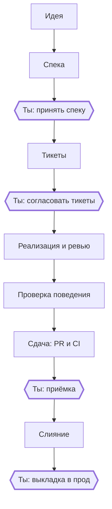
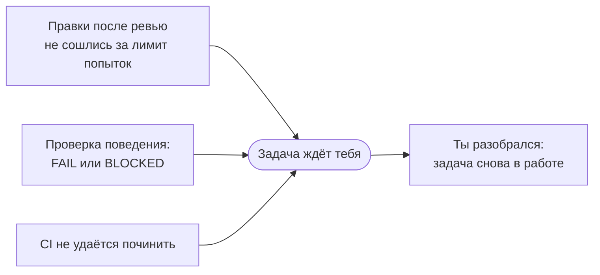
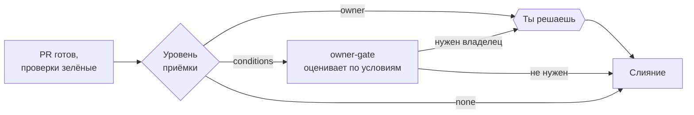
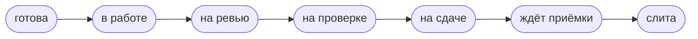
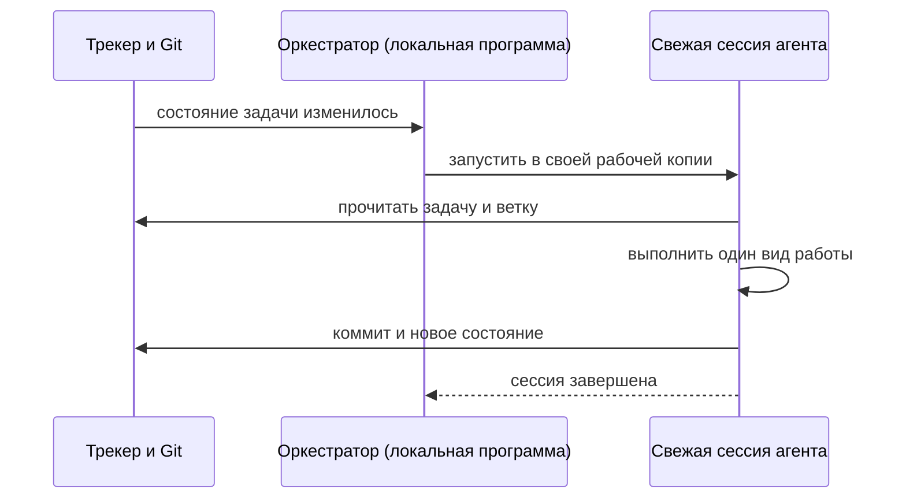
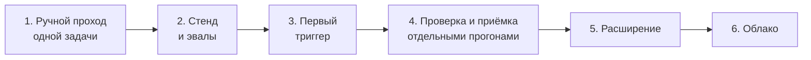
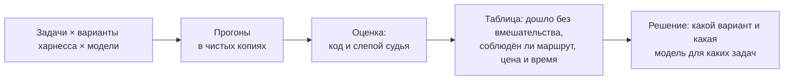

# Software Factory для Agent Kit: целевой конвейер

Рабочий документ от 23 ноября 2026 года. Фиксирует решения владельца и схемы целевого устройства. Исследование источников: [software-factory.md](software-factory.md). Карта частей: [parts.ru.md](../parts.ru.md). Стенд: [№ 11](https://github.com/KirillSachkov/agent-kit/issues/11).

## Принятые решения

1. **Определение.** Фабрика — это способ работы, при котором сессии агентов запускает событие, а не человек. Интерфейс человека — трекер и PR. PR читает человек; тёмная фабрика целью не ставится. Определение взято у Мэтта Покока.
2. **Точки решения владельца.** Принять спеку, согласовать тикеты, приёмка, выкладка в прод. Всё между ними делает фабрика.
3. **Способ связи.** Части связаны состоянием задачи в трекере и Git. Каждый вид работы — отдельный прогон в свежей сессии. Скиллы друг друга не вызывают сверх того, что заложено в оригиналах. Выбор предварительный: стенд сравнит его с одной длинной сессией.
4. **Где работает.** Пока только локально, на машине владельца через Orca.
5. **Главная мера.** Доля задач, дошедших от тикета до принятого PR без вмешательства владельца между точками решения. Рядом время, стоимость и число возвратов.
6. **Стенд.** Учебные проекты разной сложности и копии двух-трёх настоящих проектов. Нужно видеть, как разные модели идут по конвейеру, соблюдают ли его и как изменения харнесса на это влияют.
7. **Порядок.** Шесть этапов. Ручной проход владелец делает сам на своих проектах; в Kit конвейер проверяют автоматические прогоны агентов.
8. **Разделение ответственности.** Хостинг держит задачи, их состояние, PR, CI и правила слияния. Локальная машина запускает сессии агентов, ведёт порядок шагов и проверяет поведение.
9. **Единица — команда одного шага.** Вся логика шага живёт в одной команде: проверить состояние задачи, запустить агента с командой скилла, проверить результат, перевести задачу дальше. Локальная программа, GitHub Actions и GitLab CI только вызывают её. Сначала делается локальный запуск. Orca не рассматривается.
10. **Описание цепочки — один файл данных в проекте.** Шаги, условие запуска, признак завершения, следующий шаг, лимит попыток. Создаёт и обновляет его `/setup-agent-kit`.
11. **Состояние задачи живёт в трекере.** Команда шага читает и меняет его через те же описания трекера, что уже использует Kit: GitHub, GitLab или локальные файлы.
12. **Слияние запирает хостинг.** При уровне приёмки «всегда владелец» настройка предлагает включить защиту ветки.
13. **Сначала сравнение исполнителей.** Команды шагов против одной сессии-дирижёра, которая ведёт цепочку сама. Пять ситуаций: всё проходит, замечание на ревью, провал проверки поведения, CI падает и чинится, CI не чинится. По три попытки на маленькой, средней и большой модели. Меры: верное конечное состояние, полнота и порядок шагов, отсутствие лишнего, стоимость.

### Решения после прогонов 23 ноября

Измерения лежат в [описании эксперимента](../../experiments/factory/README.md). Эти решения уточняют пункты выше; пункт 4 в части Orca и пункт 13 закрыты.

14. **Слова.** Берём словарь Мэтта Покока из его скилла `software-factory`. Тикет — работа, которую ведут: тикет или спека с тикетами. Задача — вид работы, описанный один раз: реализация, проверка, доставка, доработка. Запуск — одно выполнение задачи в свежей сессии клиента. Оркестратор стартует запуски и записывает их. Исполнитель — машина, где идут запуски; пока это машина владельца.
15. **Два способа работы.** По шагам: владелец сам запускает `/implement` или `/implement-spec`, потом `/merge`. Целиком: `/deliver <тикет>` запускает оркестратор. Скиллы и настройки проекта у обоих способов общие, файл цепочки нужен только второму.
16. **Сессия-дирижёр убрана.** Она прошла 43 прогона из 130: субагент получает `/implement` как обычный текст и пишет код без скилла и без ревью. Оркестратор прошёл 69 из 72 на Claude Code и Codex.
17. **Защита ручных скиллов — только флаги.** Строка со списком ручных скиллов убрана из корневого блока, как в оригинале Мэтта.
18. **Рабочая копия.** Оркестратор создаёт тикету отдельную рабочую копию, если запущен на основной ветке, и работает в текущей, если владелец уже ушёл с неё. После каждого запуска он запоминает ветку, на которой оказалась работа. Для ручного режима настройки проекта называют место реализации, а корневой блок велит не начинать её в основной копии на основной ветке.
19. **Запуск не зависит от сессии.** Оркестратор стартует отдельно, держит блокировку на тикет и хранит состояние в файлах. `status`, `stop` и повторный `run` работают из любой сессии. Остановленный или заблокированный тикет продолжается с той же задачи.
20. **Фидбэк владельца.** Замечания к результату пишутся в PR, изменения самой работы — в тикет. Затем та же команда проводит тикет через доработку, проверку и доставку.
21. **Клиенты.** Claude Code и Codex встроены, любой другой клиент добавляется строкой с командой в файле цепочки. У задачи могут быть свои клиент и модель. Модели субагентов цепочка не задаёт: это настройка клиента, см. [модели](../models.ru.md).
22. **Ревью остаётся внутри реализации.** Отдельная задача ревью с переходом на доработку при провале отложена, пока на настоящем проекте не понадобится ревью другой моделью.
23. **Отчёт проверки.** Настройки проекта называют папку отчёта, `pr` берёт раздел «Проверено» оттуда. Проверка задачи не принимает отчёт, написанный для другого коммита.
24. **Перенос в Kit.** `deliver`, оркестратор и создание файла цепочки в `/setup-agent-kit` остаются в эксперименте до пробы на настоящем проекте.

## Основной путь

Шестиугольники — четыре точки, где решение твоё. Между согласованием тикетов и приёмкой фабрика работает сама.

## Когда конвейер останавливается и зовёт тебя

Три причины. Во всех остальных случаях он идёт дальше сам.

## Приёмка: три уровня

Уровень задаётся настройкой проекта. По умолчанию — owner.

## Как связаны прогоны

Прогоны не вызывают друг друга. Каждый меняет состояние задачи в трекере и завершается, а новое состояние запускает следующий. Из любого шага задача может уйти в «ждёт тебя».

## Один прогон изнутри

Прогон никогда не ждёт человека. Память между прогонами только в трекере и Git.

## Порядок внедрения

Каждый следующий этап добавляется после того, как предыдущий показал себя.

## Стенд

Метод взят из курса Anthropic об эвалах и плейбука pstack: 20–50 задач, ожидаемый результат записан до прогона, проверка кодом где возможно, слепой судья для остального.

25. **Скилл доставки называется `merge`.** До 2026-11-25 он назывался `ship`. В Claude Code 2.1.330 появился встроенный `/ship`, и проектный скилл с таким именем там не загружается. Задача пайплайна переименована вместе с ним. Скилл владеет слиянием и уборкой после него на обоих путях; `deliver` вызывает его по одобрению владельца.

## Что ещё не решено

- Нужен ли явный предел кругов «починил, отправил, жду CI» внутри одного запуска доставки: сейчас его ограничивает только время запуска.
- Запуск оркестратора по событию трекера или расписанию, без сессии.
- Задачи из настоящих проектов на стенде: сейчас он меряет только учебный проект.
