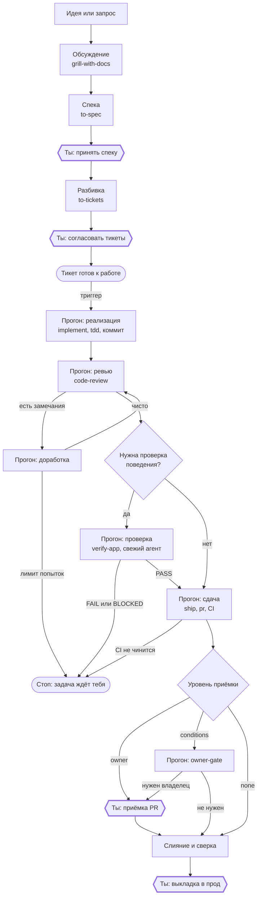
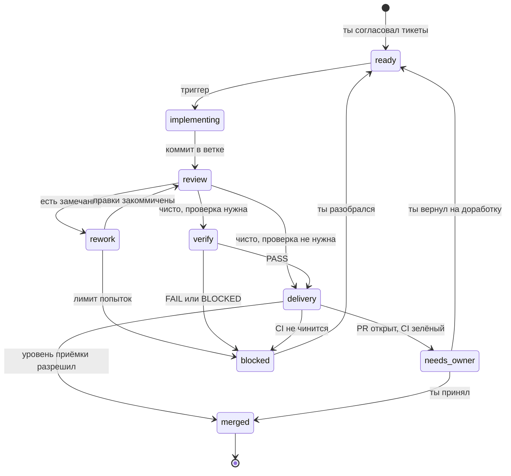
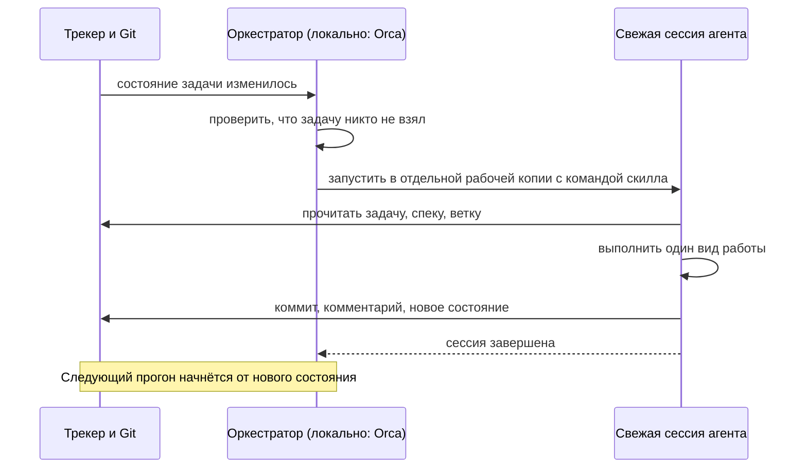
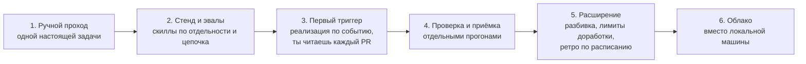
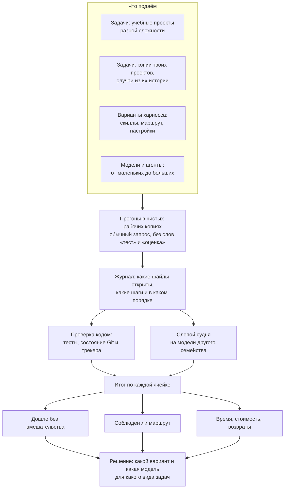

# Software Factory для Agent Kit: целевой конвейер

Рабочий документ от 23 ноября 2026 года. Фиксирует решения владельца и схемы целевого устройства. Исследование источников: [software-factory.md](software-factory.md). Карта частей: [parts.ru.md](../parts.ru.md). Стенд: [№ 11](https://github.com/KirillSachkov/agent-kit/issues/11).

## Принятые решения

1. **Определение.** Фабрика — это способ работы, при котором сессии агентов запускает событие, а не человек. Интерфейс человека — трекер и PR. PR читает человек; тёмная фабрика целью не ставится. Определение взято у Мэтта Покока.
2. **Точки решения владельца.** Принять спеку, согласовать тикеты, приёмка, выкладка в прод. Всё между ними делает фабрика.
3. **Способ связи.** Части связаны состоянием задачи в трекере и Git. Каждый вид работы — отдельный прогон в свежей сессии. Скиллы друг друга не вызывают сверх того, что заложено в оригиналах. Выбор предварительный: стенд сравнит его с одной длинной сессией.
4. **Где работает.** Пока только локально, на машине владельца через Orca.
5. **Главная мера.** Доля задач, дошедших от тикета до принятого PR без вмешательства владельца между точками решения. Рядом время, стоимость и число возвратов.
6. **Стенд.** Учебные проекты разной сложности и копии двух-трёх настоящих проектов. Нужно видеть, как разные модели идут по конвейеру, соблюдают ли его и как изменения харнесса на это влияют.
7. **Порядок.** Шесть этапов, начиная с ручного прохода одной настоящей задачи.

## Целевой конвейер: от идеи до прода

Шестиугольники — четыре точки, где решение всегда твоё. Каждый прямоугольник после «тикет готов» — отдельный прогон в свежей сессии.

## Как связаны прогоны: состояние задачи в трекере

Прогоны не вызывают друг друга. Каждый читает задачу, делает свою работу, меняет её состояние и завершается. Смена состояния запускает следующий прогон.

## Один прогон изнутри

Прогон никогда не ждёт человека. Память между прогонами только в трекере и Git.

## Порядок внедрения

Сначала тормоза, потом ускорители: каждый следующий этап добавляется после того, как предыдущий показал себя.

## Стенд: что с чем сравниваем

Предварительная схема. Метод взят из курса Anthropic «Introduction to evals» и статьи «Demystifying evals for AI agents»: 20–50 задач из реальных случаев, ожидаемый результат записан до прогона, проверка кодом везде, где возможно, судья только для остального. Модель выбирается так: сначала порог успешности, затем самая дешёвая по цене за выполненную задачу среди прошедших порог.

## Что ещё не решено

- Ревью отдельным прогоном или внутри реализации, как в оригинальном `implement`.
- Лимит попыток доработки и исправления CI.
- Как локальный оркестратор узнаёт о смене состояния и защищается от двойного запуска.
- Набор задач и способ оценки на стенде.
