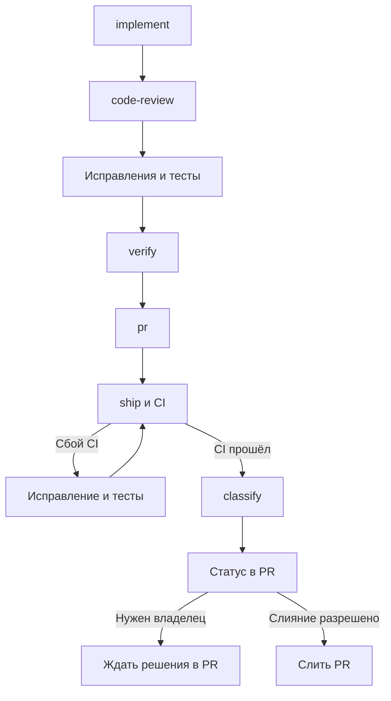
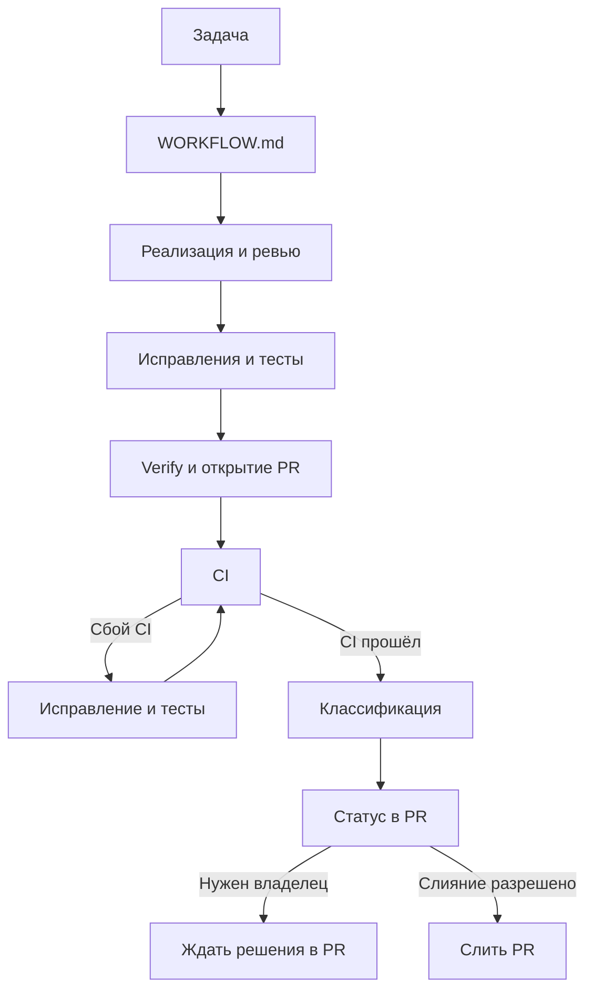

# Два варианта харнесса поставки

[Результаты прогонов](RESULTS.md) · [Критерии оценки](CRITERIA.md)

Это две воспроизводимые **экспериментальные** сборки одного процесса. Варианты отличаются тем, где ведущий агент находит следующий шаг. Оба читают один текст задачи, пользуются одними процедурами и выполняют реальные команды в локальном учебном проекте. Политику выбираем до запуска.

## A. Скиллы передают работу друг другу

Корневая инструкция отправляет агента в `implement`. При сборке каждому скиллу добавляется его абзац о передаче результата. Например, `implement` вызывает ревью и принимает замечания, `verify` передаёт проверенный результат в `pr`, а `ship` вызывает классификатор после CI. Чтобы проследить все переходы, нужно прочитать указания нескольких скиллов. [Вход](variants/skill-chain/AGENTS.md) · [Переходы по скиллам](variants/skill-chain/handoffs)



## B. Ведущий агент следует маршруту проекта

Корневая инструкция отправляет агента в `WORKFLOW.md`. Там собраны те же шесть абзацев о переходах. Ведущий агент обращается к скиллам за конкретной работой и использует их результаты, чтобы пройти маршрут. Это текстовый workflow. Нового процесса, постоянно работающего субагента или сервера для него не требуется. [Вход](variants/project-workflow/AGENTS.md) · [Весь маршрут](variants/project-workflow/WORKFLOW.md)



## Где принимаются решения

| Решение | В какой момент и чья ответственность |
| --- | --- |
| Что сдаём вместе | При назначении работы. Базовый вариант — вся спецификация в одном PR. Самостоятельные поставки можно согласовать заранее. В эксперименте одна задача образует один PR. |
| Как разработать и проверить изменение | Исполнитель делает изменение по задаче. Проектный `testing.md` задаёт затронутые тесты. В полном Kit здесь при необходимости используется оригинальный TDD. |
| Что смотрят ревьюеры | На всю поставку приходится один вызов `code-review`. Standards и Spec одновременно проверяют один снимок. Автор разбирает оба результата за один проход и запускает затронутые тесты. |
| Где доказано поведение | Локальный Verify проходит после исправлений, до PR. В пилоте он обязателен по правилам проекта. Его результат и версия остаются в PR. |
| Что делать при падении CI | `ship` ведёт исправление, затронутые тесты и новый CI. В PR указываются исправление после Verify и окончательная версия. Успешный Verify и ревью второй раз не запускаются. |
| Нужна ли твоя проверка | Классификатор применяет правило проекта к фактическому изменению после зелёного CI. В пилоте сравниваются два проекта с одинаковой задачей и разной политикой. Запрос на просмотр конкретной задачи — отдельный возможный вход полноценного Kit. |
| Что показывается и кто сливает | `pr` записывает статус, версии и основание. Вопрос остаётся в PR. `ship` сливает при разрешении проекта или ждёт. Деплой и появление изменения у конечного пользователя зависят от отдельного процесса проекта. В эксперименте конечная точка — локальная модель приёмки PR. |

## Что выполняется в опыте

В JSON-to-CSV CLI агент добавляет колонку скидки. В роли двух ревьюеров работают независимые детерминированные проверки одного снимка. Standards сообщает об устаревшем примере заголовка. Spec запускает CLI. После исправления и Verify локальный адаптер CI сообщает об устаревшем описании колонок пакета. Эти два расхождения заложены в исходную задачу, чтобы у каждого варианта были одинаковые развилки. Работу с кодом, порядок вызовов, исправления, выбор следующего действия и подготовку отчёта выполняет испытуемая модель. [Проект и процедуры](shared) · [Параметры приёмки](policies)

Чтобы открыть обе сборки рядом и прочитать их как обычные проекты, выполни из корня Kit:

```sh
python3 experiments/delivery-routing/run.py /tmp/kit-example-a --prepare skill-chain
python3 experiments/delivery-routing/run.py /tmp/kit-example-b --prepare project-workflow
```

Эти команды создают каталоги по указанным новым путям без вызова моделей.

Каждая попытка получает новый каталог и отдельную сессию Codex CLI. Для повтора нужен Python 3.11+, доступный локальный Codex CLI и доступ к выбранным моделям. Обработка 16 сессий использует квоту выбранного аккаунта. Результаты остаются локальными.

```sh
python3 experiments/delivery-routing/run.py /tmp/kit-routing-new-run --jobs 4
python3 experiments/delivery-routing/score.py /tmp/kit-routing-new-run
```

Для окончательной оценки прочитай показанные заметки PR, затем передай `--notes verdicts.json` с объектом вида `{"trial-id": true}`. `--output scores.json` сохраняет результаты и квитанции. Сырой вывод клиента хранится в каталоге каждой попытки. Техническая часть оценки проверяет журнал операций, исходные инструкции, версии результатов, итоговый PR и работу CLI на другом примере. Текст финального ответа модели баллов не добавляет.
