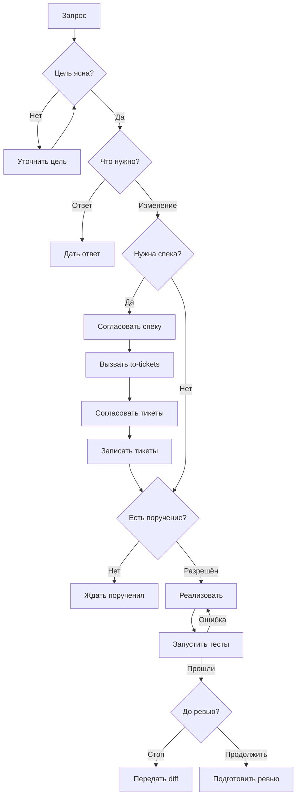
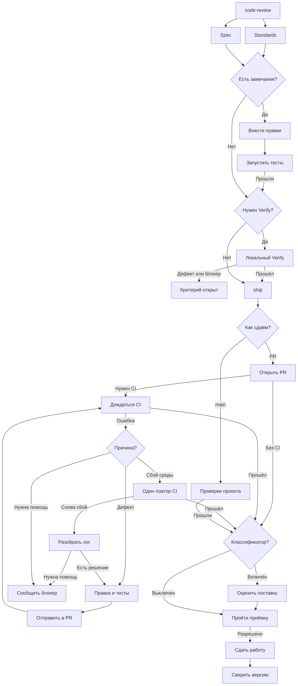

> Candidate for the later comparison of ways to assemble a workflow. It was the starter's `WORKFLOW.md` until 2026-11-23 and is not installed.

# Agent Kit workflow

## Choose the requested work

- **Discuss or investigate.** Return the decision, diagnosis or observations. An issue reference identifies the subject.
- **Prepare a spec.** The owner invokes `to-spec`. Read back the saved spec before linking it. On acceptance alone, end the reply with the spec reference and the next command for the owner's client (`$to-tickets <spec>` in Codex, `/to-tickets <spec>` in Claude Code). If the owner invokes it in the acceptance message, begin the breakdown immediately.
- **Prepare tickets.** In `to-tickets`, propose the slices and dependencies. On approval, save the agreed tickets in the configured tracker, verify their references and show the ready tickets. This completes planning.
- **Implement.** A direct assignment to implement one task counts as the owner invoking `implement` when the project's start rule allows it: read that skill and follow it. For an entire spec, the owner invokes `implement-spec` against its published ticket graph. A ready ticket, an accepted spec and approval to publish tickets each describe planning state.
- **Review.** `implement` and `implement-spec` call `code-review` once on the finished work. Resolve its findings in one pass and rerun the affected tests.
- **Verify.** When the project requires it, run the project's `verify-<app>` skill once on the corrected revision, before a PR is opened or a draft PR is marked ready. Check every acceptance criterion and record the action, the observation and the revision. A product failure or an unavailable environment keeps delivery open; record which one it was. Without a verify skill, ask the owner to run `create-verification-skill`.
- **Deliver.** `ship` takes the review reports, fixes, test results and Verify record through the configured local, main or PR route.
- **Stop or resume.** Use the assigned endpoint, bounded by project authority. “Stop before review” returns the tested change and its review base instead of calling `code-review`. A standalone `code-review` returns the findings. A request to deliver resumes from the recorded handoff.

Read the project settings for the start rule and delivery authority.

On a narrow display, pan or expand each diagram to read it at its natural size.

## От запроса до ревью

## От ревью до сдачи

A delivery is one PR or one main-checkout handoff. Grouped tickets share a review. Verify records the local revision. CI records the final revision and the changes between them. Keep a failed required check open.
