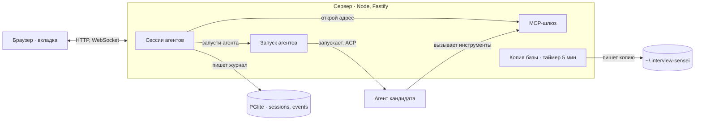
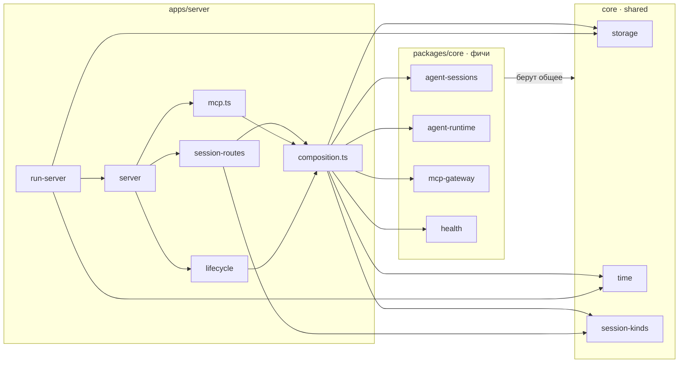
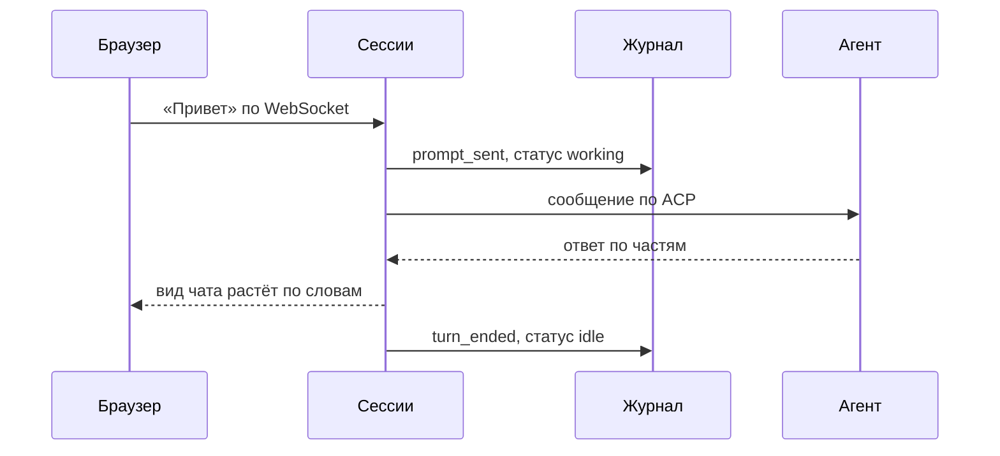
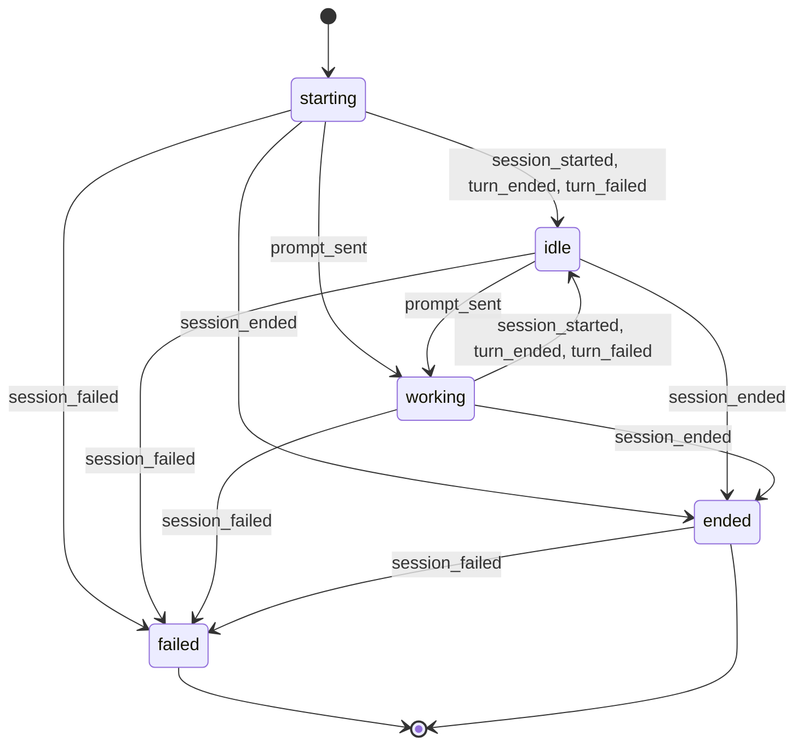

Локальное приложение: кандидат открывает его в браузере, а сервер запускает его собственного агента и ведёт с ним разговор.

## Браузер говорит только с сервером, агент работает отдельным процессом на каждую сессию

Фичи `agent-sessions`, `agent-runtime` и `mcp-gateway` живут внутри процесса сервера; агент отдельный процесс на каждую сессию.

## Фичи core импортирует только composition.ts

Построено из импортов ветки. Правило `server-composes-features-in-one-module` пускает к фичам core только `composition.ts`; общие модули `storage`, `time` и `session-kinds` открыты каждому файлу сервера. [[apps/server/.dependency-cruiser.cjs]] Фичи core друг друга не импортируют и берут только общие модули.

## Сообщение доходит до агента и возвращается потоком

1. Кандидат пишет в чат; браузер отправляет текст серверу по WebSocket.
2. Сессия записывает событие в журнал до отправки агенту.
3. Сессия передаёт текст процессу агента по ACP.
4. Агент отвечает частями; каждая часть ложится в журнал.
5. Сервер собирает вид чата из журнала, и ответ в браузере растёт по словам.
6. Ход закончен, статус снова idle.

## Статус сессии меняют шесть событий

Переходы взяты из каждой ветки `statusAfter`: живой статус (`starting`, `idle`, `working`) принимает все события, `session_failed` ведёт в `failed` из любого статуса. [[packages/core/src/features/agent-sessions/domain/session-view.ts:13-38]]
