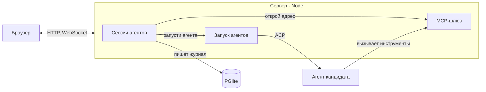
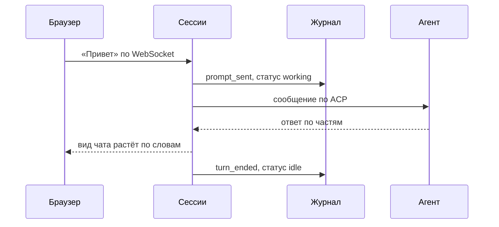
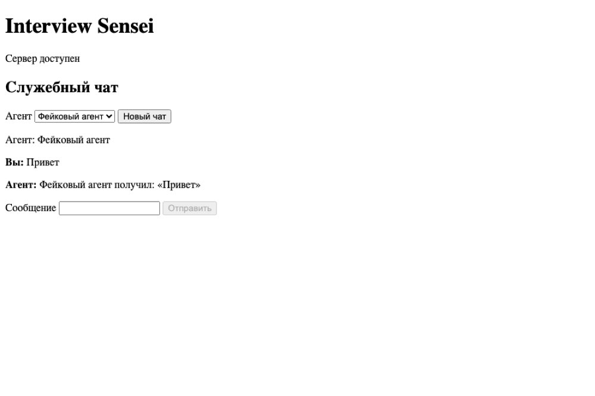
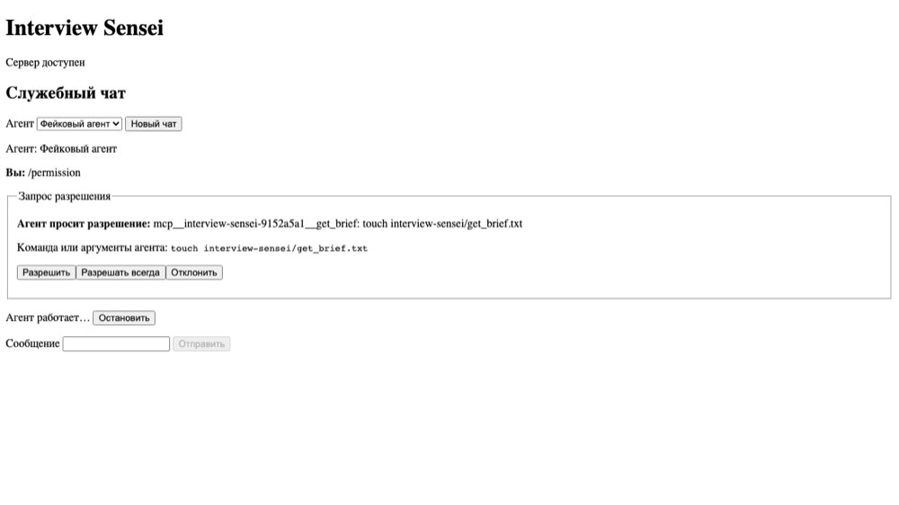

# Скелет Interview Sensei версии 1 в main

**Готово** · spec #17 · PR #28 смержен 2026-11-09 · агент Claude Code

[PR #28](https://github.com/KirillSachkov/interview-sensei/pull/28) · [spec #17](https://github.com/KirillSachkov/interview-sensei/issues/17) · [CI на 1f3140b](https://github.com/KirillSachkov/interview-sensei/actions/runs/42570301103)

**8 из 8** тикетов принято · **188** тестов прошло · **3** агента проверены вживую

Минимальное приложение работает: одна команда запускает сервер и браузер, кандидат переписывается со своим агентом (Claude Code, Codex или OpenCode) в изоляции, история сохраняется после перезапуска.

## Что сделано
- ✅ Каркас и проверки архитектуры. `pnpm check` ловит нарушения границ, циклы и мёртвый код. [#20](https://github.com/KirillSachkov/interview-sensei/issues/20)
- ✅ Каталог данных и хранилище. PGlite, копия каждые 5 минут, lock от второго запуска. [#21](https://github.com/KirillSachkov/interview-sensei/issues/21)
- ✅ Служебный чат. Поток ответа, остановка хода, история после перезапуска. [#22](https://github.com/KirillSachkov/interview-sensei/issues/22)
- ✅ MCP на сессию и разрешения. Свой адрес и `get_brief`; чужие действия решает кандидат. [#23](https://github.com/KirillSachkov/interview-sensei/issues/23)
- ✅ Настоящие агенты в изоляции. Ручная проверка трёх агентов пройдена. [#24](https://github.com/KirillSachkov/interview-sensei/pull/28#issuecomment-6726075834)
- ✅ Сборка фич через модули. Один `composition.ts` собирает фичи. [#34](https://github.com/KirillSachkov/interview-sensei/issues/34)
- ✗ Публикация в npm. Не входила в скелет.

## Как работает
### Браузер говорит только с сервером, а агент работает отдельным процессом

Браузер и агент узнают друг о друге только через сервер.

### Сообщение доходит до агента и возвращается потоком

1. Кандидат пишет в чат; браузер отправляет текст серверу по открытому WebSocket.
2. Сессия сначала записывает событие в журнал. Так сообщение не потеряется даже при падении.
3. Сессия передаёт текст процессу агента по протоколу ACP.
4. Агент отвечает частями; каждая часть тоже ложится в журнал.
5. Сервер собирает вид чата из журнала и шлёт браузеру. Ответ растёт по словам.
6. Ход закончен: статус снова idle, можно писать дальше.

## Как выглядит




## Как проверено
- ✅ Все 4 проверки CI на `1f3140b` прошли. [CI](https://github.com/KirillSachkov/interview-sensei/actions/runs/42570301103)
- ✅ Тесты: `pnpm test`, 121 unit и 61 integration прошли. [PR #28](https://github.com/KirillSachkov/interview-sensei/pull/28)
  ```text
  Test Files  58 passed (58)
       Tests  182 passed (182)
  ```
- ✅ Сценарии в браузере: `pnpm test:e2e`, 6 сценариев Playwright прошли. [PR #28](https://github.com/KirillSachkov/interview-sensei/pull/28)
- ⚠️ Не проверено: путь `pnpm dev` через прокси Vite; чужой `Host` на маршруте MCP.

**Как повторить:**
1. Запусти `pnpm install && pnpm build && pnpm start`. Откроется браузер на странице «Служебный чат».
2. Начни новый чат и напиши «Привет». Ответ будет расти по словам.
3. Попроси агента выполнить `touch probe.txt`. Появится запрос разрешения, а после «Отклонить» файла не будет.

## Решения
- **Сервер слушает только loopback.** Итоговое ревью нашло, что иначе агентом может управлять любой компьютер в сети. От правила только в документации отказались на итоговом ревью.
- **Фичи собираются в одном composition.ts.** Файлов сервера с импортом core стало 3 вместо 7.

## Риски
- **Меняется весь код приложения.** `main` до этого содержал только harness. Откатить можно через revert squash-коммита.
- **Кнопки разрешений на английском.** Показывают «Yes», «No» из адаптера. → вопрос 1

## Что дальше
1. Первый предметный срез версии 1.

**Нужно от тебя**

❓ **1. Подписи кнопок разрешений.** Сейчас кнопки показывают «Yes» и «No» прямо из адаптера агента, а весь остальной интерфейс на русском.
- **А (рекомендую).** Перевести их в первом предметном срезе.
- **Б.** Оставить до версии 2.

Ответь: 1А или 1Б.
