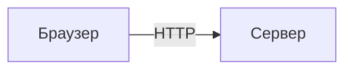

# recap.md

A recap is plain Markdown. The same text is the chat reply, the PR body, the file, and the source of the page.
Headings and labels follow the reader's language; the Russian ones below are an example.
In a PR body, drop the `#` title: the PR title carries it.
Show a section only when the work has something true to put in it. «Как выглядит» shows the change before and after when behaviour or a screen changed.

````markdown
# Скелет версии 1 работает

**Готово** · spec #17 · PR #28 · ветка `spec/17-skeleton`

[PR #28](https://github.com/o/r/pull/28) · [CI](https://github.com/o/r/actions/runs/1)

**8 из 8** задач закрыты · **188** тестов прошло

One or two sentences: what now works. This first paragraph is the verdict, without code or paths.

## Что сделано
- ✅ Item of the task. What came out. `path/to/file.ts:42`
- ◐ Partly done. What is missing.
- ✗ Not done or failed. Why.

## Как работает
### The takeaway as a sentence

One line under the diagram: what to look at.

## Как выглядит
| Было | Стало |
|---|---|
| Behaviour or screen before | After |


In a PR body, an image needs a URL GitHub can show: upload it to the PR, not a path in the repository.

## Как проверено
- ✅ Тесты: `pnpm test`, 182 passed.
- ⚠️ Not checked: what nobody ran.

## Решения
- **Choice the agent made.** Why. Name a rejected option only when a record of it exists: the conversation, an issue or a comment.

## Риски
- **What can break.** For whom, and how to roll it back. → вопрос 1, when the owner must act on it

## Что дальше
1. What the agent or the project does next. Steps for the owner go to the block.

**Нужно от тебя**

❓ **1. Short name.** What to decide and why.
- **А (рекомендую).** The option and what it leads to.
- **Б.** An alternative.

Ответь: 1А или 1Б.
````

## Marks

| Mark | Meaning |
|---|---|
| `✅` `◐` `✗` `⚠️` at the start of a list item | done, partial, not done or failed, not checked or attention |
| `` `path:line` `` after a claim | where in the code the claim holds, so the owner can open it |
| a link `[text](https://…)` | a PR, a CI run, an issue |
| `→ вопрос 1` at the end of a decision or a risk | the owner acts on it through that question of the block |

## Diagrams

Use Mermaid: GitHub draws it in the PR, and the page draws it in the browser.

| Question | Diagram |
|---|---|
| How the parts connect | `flowchart LR`, 4–10 nodes; `subgraph` for a process or package |
| What happens in order | `sequenceDiagram`; an ordered list right after it gives one plain note per message |
| Which states an entity has | `stateDiagram-v2`, only when the work is about states |

- Every edge label is a verb: `-->|пишет журнал|`. Node labels up to 4 words.
- Mark the work's change: `:::added`, `:::changed`, `:::removed`; `:::external` for parts outside the system.
