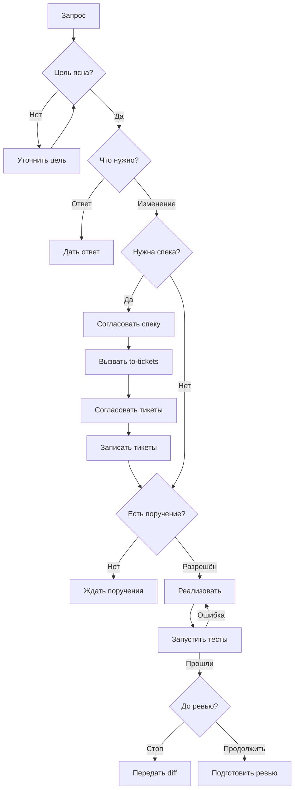
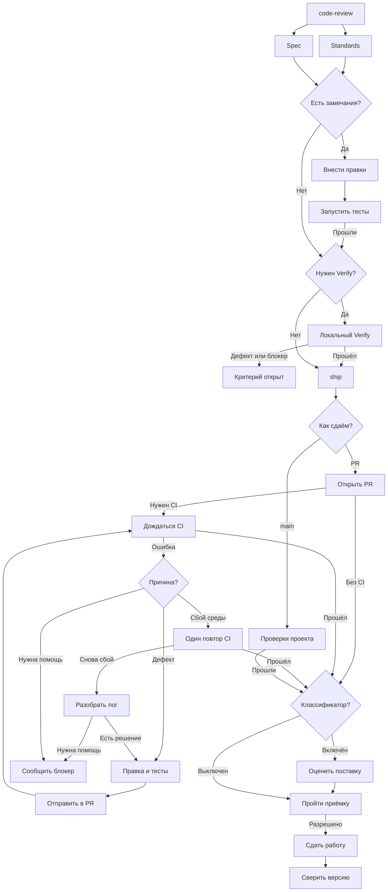

# Agent Kit workflow

## Choose the requested work

- **Discuss or investigate.** Return the decision, diagnosis or observations. An issue reference identifies the subject.
- **Prepare a spec.** The owner invokes `to-spec`. Read back the saved spec before linking it. When the owner accepts it, hand back the next command: `$to-tickets <spec>`. If the owner invokes it in the acceptance message, begin the breakdown immediately.
- **Prepare tickets.** In `to-tickets`, propose the slices and dependencies. On approval, save the agreed tickets in the configured tracker, verify their references and show the ready tickets. This completes planning.
- **Implement.** Take one assigned issue directly with `implement`. For an entire spec, a separate assignment starts `implement-spec` against its published ticket graph. Apply the project's start rule. A ready ticket, an accepted spec and approval to publish tickets each describe planning state.
- **Stop or resume.** Use the assigned endpoint, bounded by project authority. “Stop before review” returns the tested change and its review base. A standalone `code-review` returns the findings. A request to deliver resumes from the recorded handoff through the configured local or PR route.

Read the project settings for the tracker, start rule and delivery authority.

On a narrow display, pan or expand each diagram to read it at its natural size.

## От запроса до ревью

## От ревью до сдачи

A delivery is one PR or one main-checkout handoff. Grouped tickets share a review. Verify records the local revision. CI records the final revision and the changes between them. Keep a failed required check open.
