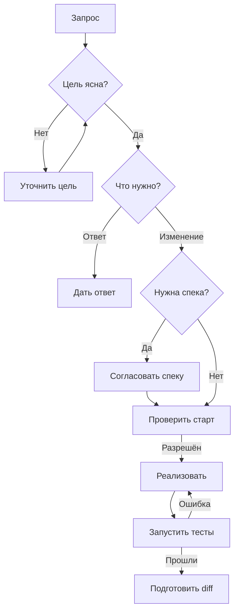
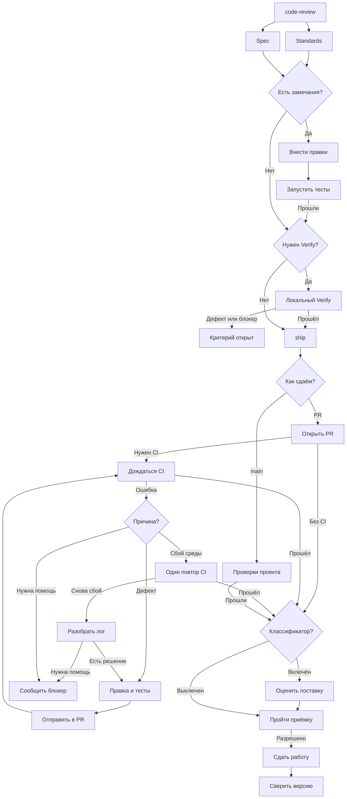

# Agent Kit workflow

These maps show the available routes. The project's root instructions select the start rule, tests, Verify scenarios, delivery mode and owner decisions.

On a narrow display, pan or expand each diagram to read it at its natural size.

## От запроса до ревью

## От ревью до сдачи

A delivery is one PR or one main-checkout handoff. Grouped tickets share a review. Verify records the local revision. CI records the final revision and the changes between them. Keep a failed required check open.
